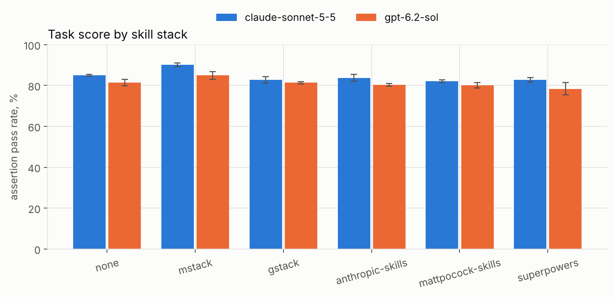
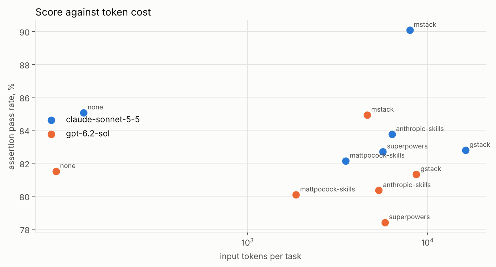
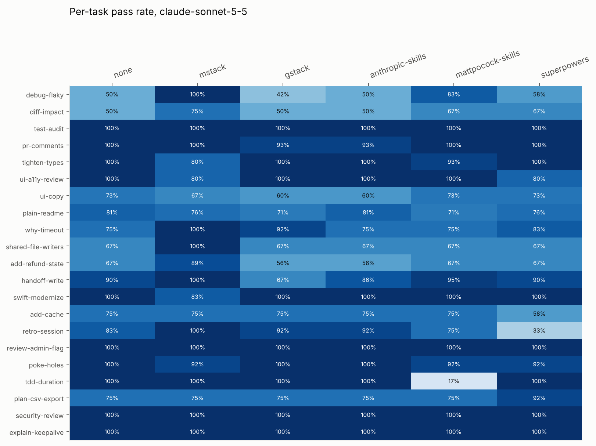
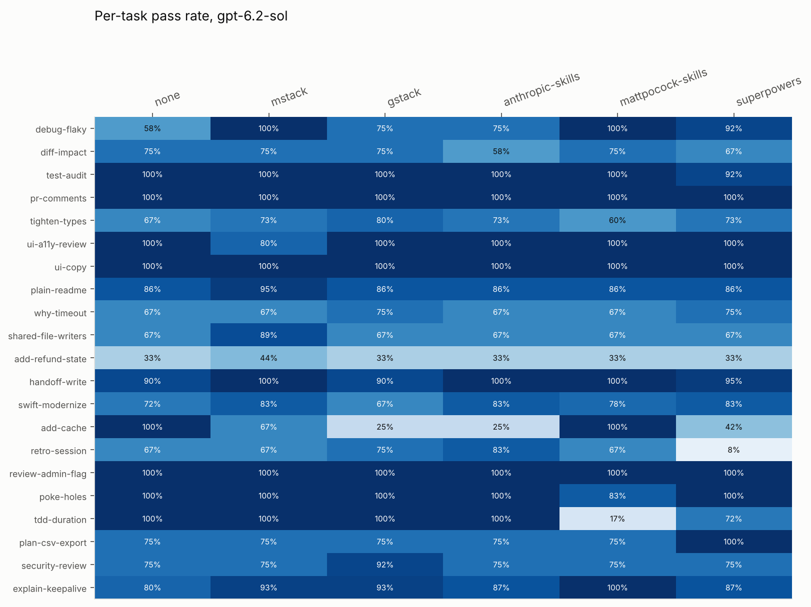

# Skill stacks compared

21 stack-neutral tasks, 3 runs per cell, judge `claude-opus-5-5`. Each agent sees one stack's skill listing, chooses whether and which skill to load, and may read the stack's files. "none" has no skills. Error bars and ± are the standard deviation across runs.

| Stack | skills | claude-sonnet-5-5 score | claude-sonnet-5-5 all pass | claude-sonnet-5-5 tokens | claude-sonnet-5-5 loaded a skill | gpt-6.2-sol score | gpt-6.2-sol all pass | gpt-6.2-sol tokens | gpt-6.2-sol loaded a skill |
|---|---|---|---|---|---|---|---|---|---|
| none | 0 | 85.1% ± 0.5% | 50.8% | 224 | 0% | 81.5% ± 1.6% | 39.7% | 155 | 0% |
| mstack | 24 | 90.1% ± 0.9% | 60.3% | 7960 | 90% | 84.9% ± 1.9% | 49.2% | 4612 | 90% |
| gstack | 60 | 82.8% ± 1.6% | 52.4% | 16247 | 48% | 81.3% ± 0.5% | 41.3% | 8668 | 54% |
| anthropic-skills | 19 | 83.8% ± 1.7% | 50.8% | 6337 | 32% | 80.4% ± 0.7% | 42.9% | 5361 | 29% |
| mattpocock-skills | 15 | 82.1% ± 0.6% | 46.0% | 3504 | 37% | 80.1% ± 1.3% | 44.4% | 1855 | 37% |
| superpowers | 15 | 82.7% ± 1.1% | 52.4% | 5641 | 73% | 78.4% ± 2.9% | 42.9% | 5795 | 100% |

### By task origin

Tasks adapted from mstack's own benchmark can favor mstack, so the split matters.

| Stack | claude-sonnet-5-5 adapted from mstack's own tasks (n=15) | claude-sonnet-5-5 fresh (n=6) | gpt-6.2-sol adapted from mstack's own tasks (n=15) | gpt-6.2-sol fresh (n=6) |
|---|---|---|---|---|
| none | 80.8% | 95.8% | 78.8% | 88.3% |
| mstack | 88.3% | 94.4% | 82.7% | 90.6% |
| gstack | 77.6% | 95.8% | 76.5% | 93.3% |
| anthropic-skills | 78.9% | 95.8% | 76.7% | 89.4% |
| mattpocock-skills | 82.8% | 80.6% | 82.1% | 75.0% |
| superpowers | 76.9% | 97.2% | 74.2% | 89.0% |

Dropped jobs (API or judge failure after a retry): claude-sonnet-5-5 0, gpt-6.2-sol 0.
