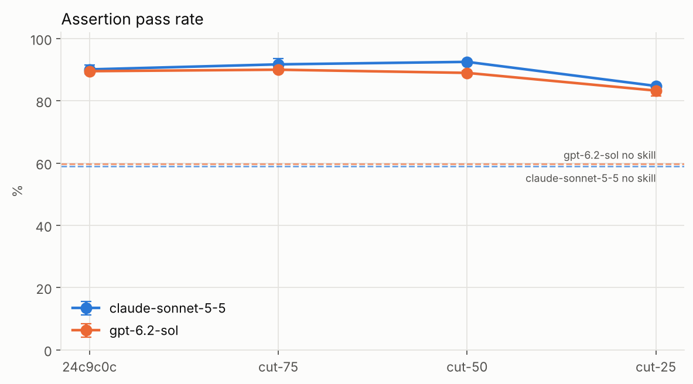
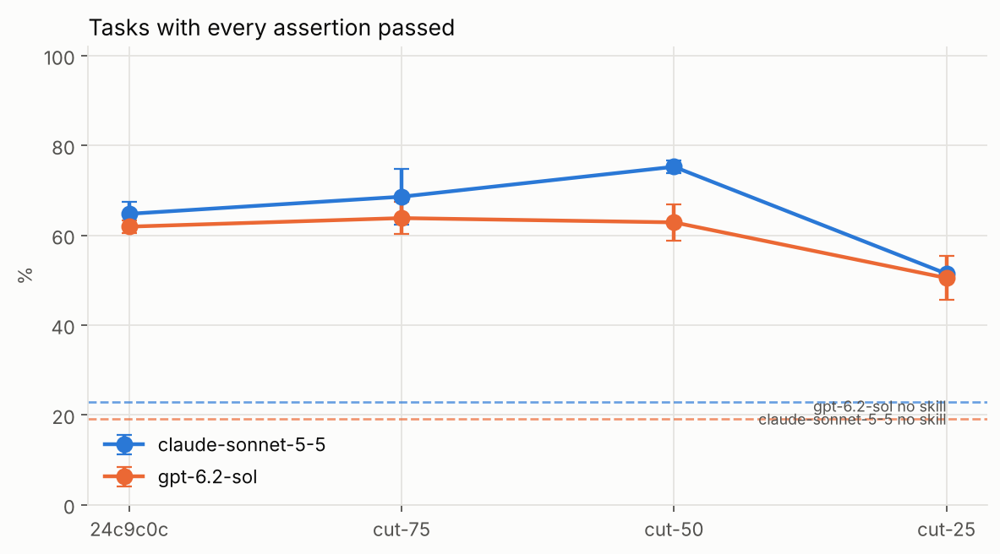
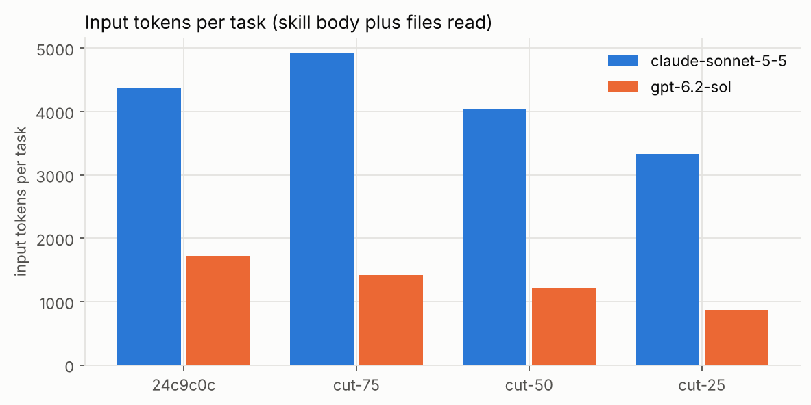
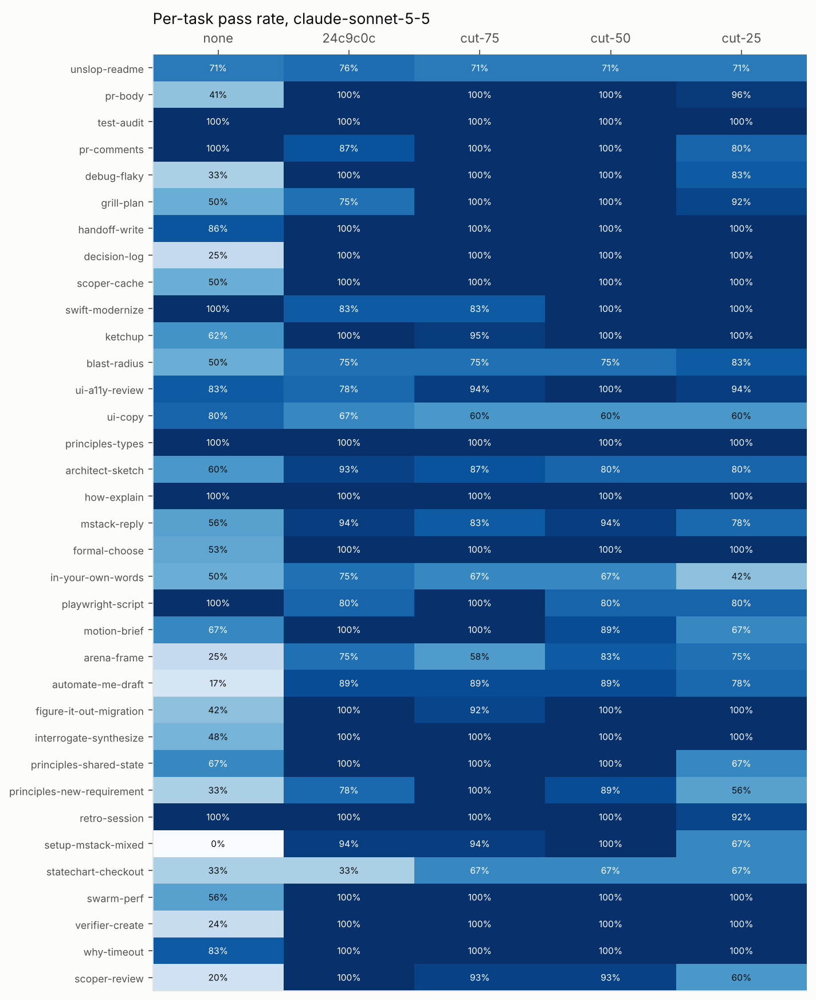
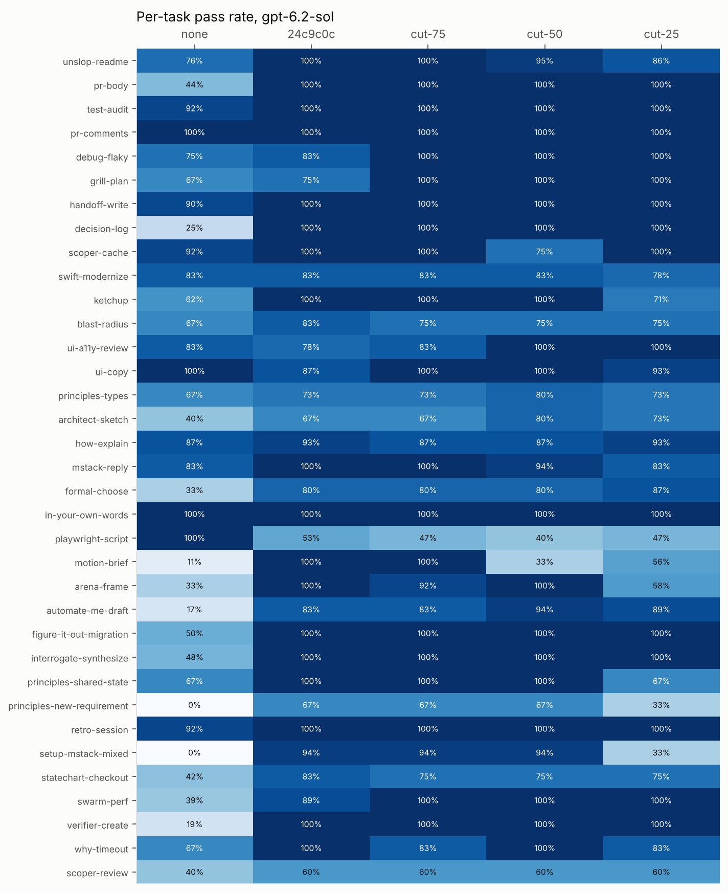
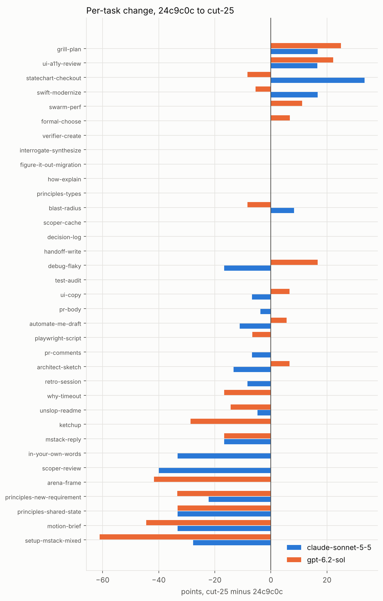
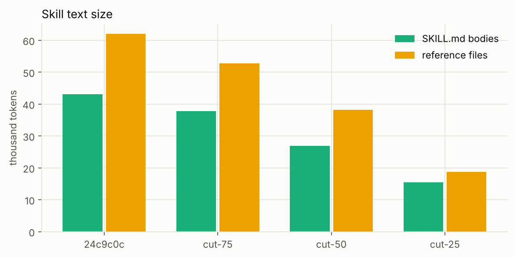
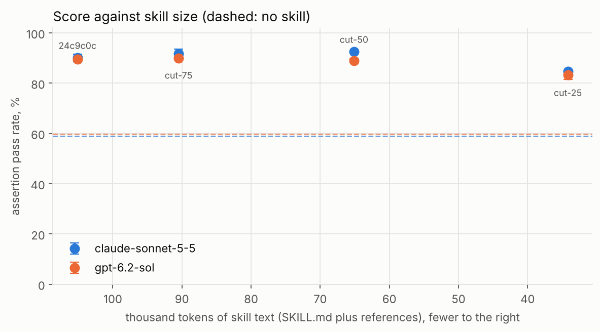

# Skill benchmark across versions

Versions, oldest first: `24c9c0c`, `cut-75`, `cut-50`, `cut-25`. Every version is scored on the same tasks and trigger queries. "none" is the same task with no skill loaded. Error bars and ± are the standard deviation across repeated runs.

## Task outcomes

35 tasks, 3 runs per cell, graded by regex checks plus judge `claude-opus-5-5`.

| Model | none | 24c9c0c | cut-75 | cut-50 | cut-25 |
|---|---|---|---|---|---|
| claude-sonnet-5-5 pass rate | 59.0% ± 0.6% | 90.1% ± 1.5% | 91.7% ± 1.8% | 92.5% ± 0.3% | 84.8% ± 0.3% |
| gpt-6.2-sol pass rate | 59.7% ± 0.7% | 89.5% ± 0.5% | 90.0% ± 0.7% | 89.0% ± 0.7% | 83.3% ± 1.7% |
| claude-sonnet-5-5 all pass | 22.9% ± 2.3% | 64.8% ± 2.7% | 68.6% ± 6.2% | 75.2% ± 1.3% | 51.4% ± 0.0% |
| gpt-6.2-sol all pass | 19.0% ± 2.7% | 61.9% ± 1.3% | 63.8% ± 3.6% | 62.9% ± 4.0% | 50.5% ± 4.9% |
| claude-sonnet-5-5 input tokens | 200 | 4381 | 4918 | 4037 | 3330 |
| gpt-6.2-sol input tokens | 140 | 1725 | 1422 | 1210 | 868 |

Dropped jobs (API or judge failure after a retry): claude-sonnet-5-5 0, gpt-6.2-sol 0.

## Size

| Metric | 24c9c0c | cut-75 | cut-50 | cut-25 |
|---|---|---|---|---|
| skill_tokens_total | 43096 | 37749 | 26920 | 15519 |
| skill_tokens_median | 1333 | 1116 | 781 | 418 |
| ref_tokens_total | 62017 | 52742 | 38196 | 18661 |
| desc_tokens | 2032 | 2032 | 2032 | 2032 |
| scoper_hook_tokens | 897 | 802 | 576 | 244 |
| broken_links | 0 | 0 | 0 | 0 |
| lint_failures | 0 | 0 | 0 | 0 |

## Score against size

