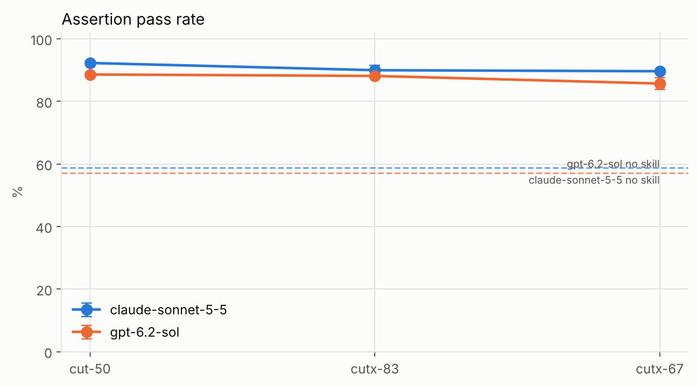
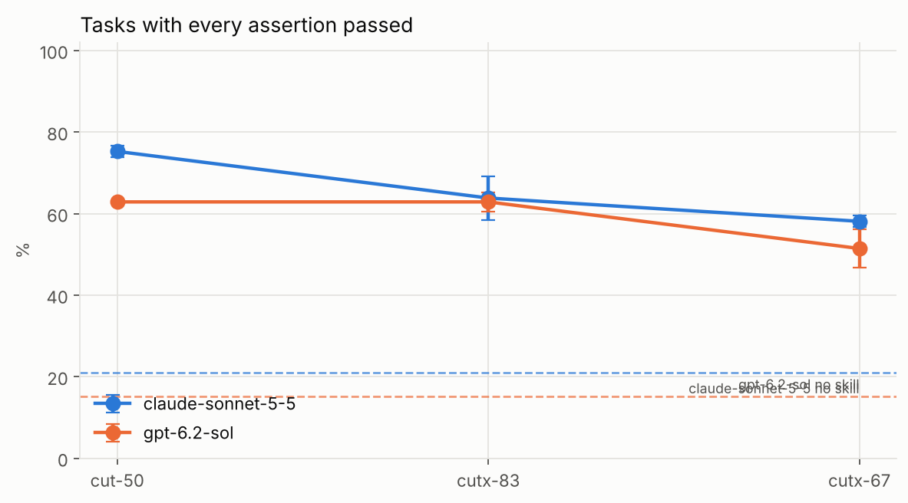
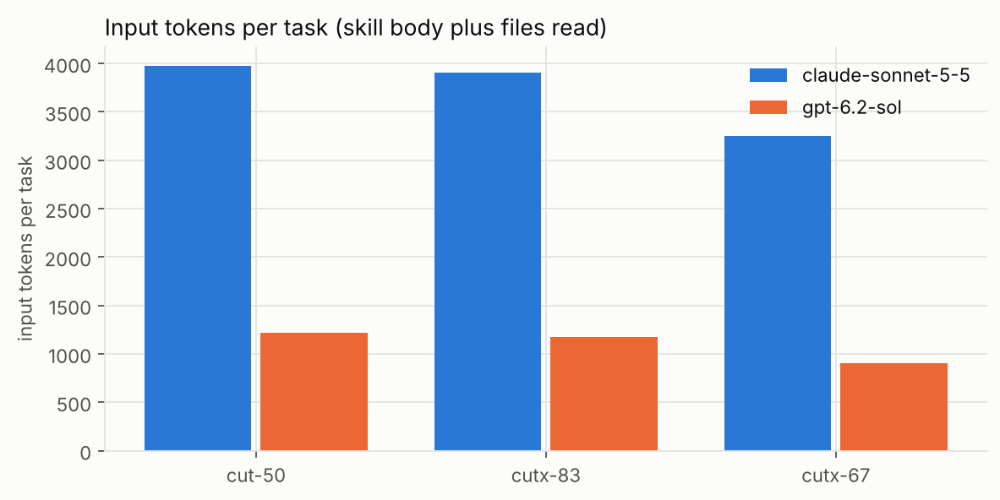
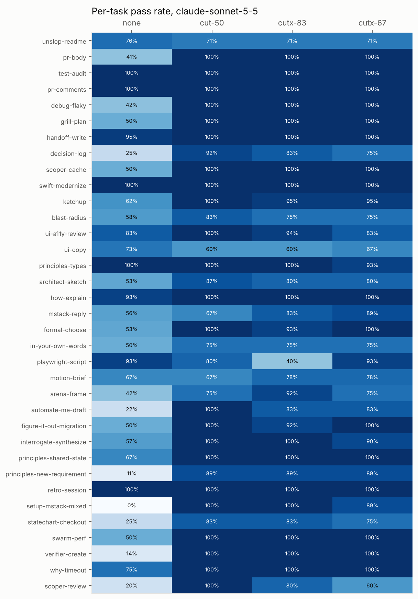
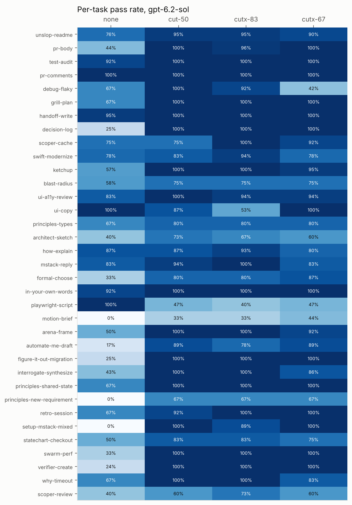
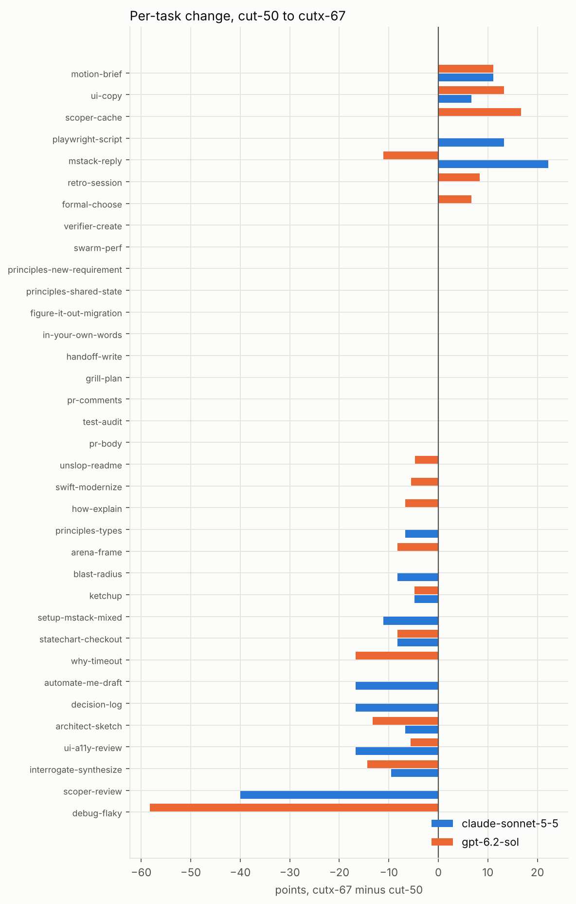
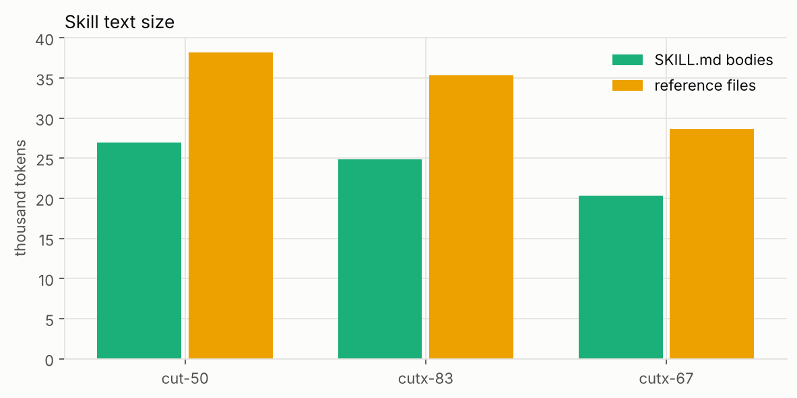
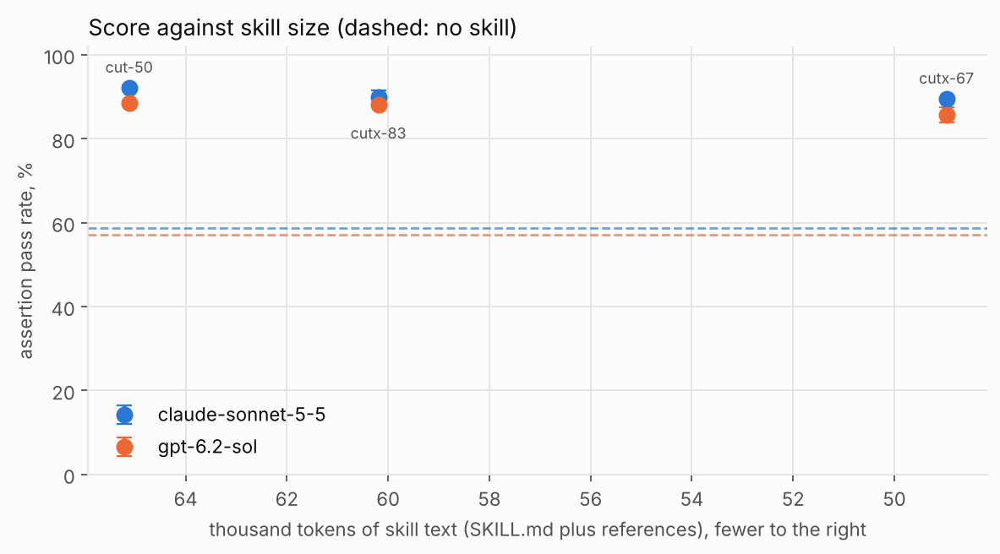

# Skill benchmark across versions

Versions, oldest first: `cut-50`, `cutx-83`, `cutx-67`. Every version is scored on the same tasks and trigger queries. "none" is the same task with no skill loaded. Error bars and ± are the standard deviation across repeated runs.

## Task outcomes

35 tasks, 3 runs per cell, graded by regex checks plus judge `claude-opus-5-5`.

| Model | none | cut-50 | cutx-83 | cutx-67 |
|---|---|---|---|---|
| claude-sonnet-5-5 pass rate | 58.7% ± 0.8% | 92.2% ± 0.6% | 89.9% ± 1.6% | 89.6% ± 0.3% |
| gpt-6.2-sol pass rate | 57.2% ± 0.4% | 88.6% ± 0.6% | 88.1% ± 0.5% | 85.7% ± 1.9% |
| claude-sonnet-5-5 all pass | 21.0% ± 4.9% | 75.2% ± 1.3% | 63.8% ± 5.4% | 58.1% ± 1.3% |
| gpt-6.2-sol all pass | 15.2% ± 1.3% | 62.9% ± 0.0% | 62.9% ± 2.3% | 51.4% ± 4.7% |
| claude-sonnet-5-5 input tokens | 200 | 3976 | 3910 | 3255 |
| gpt-6.2-sol input tokens | 140 | 1222 | 1171 | 904 |

Dropped jobs (API or judge failure after a retry): claude-sonnet-5-5 0, gpt-6.2-sol 0.

## Size

| Metric | cut-50 | cutx-83 | cutx-67 |
|---|---|---|---|
| skill_tokens_total | 26920 | 24892 | 20347 |
| skill_tokens_median | 781 | 692 | 573 |
| ref_tokens_total | 38196 | 35301 | 28624 |
| desc_tokens | 1900 | 1900 | 1900 |
| scoper_hook_tokens | 576 | 522 | 346 |
| broken_links | 0 | 0 | 0 |
| lint_failures | 0 | 0 | 0 |

## Score against size

