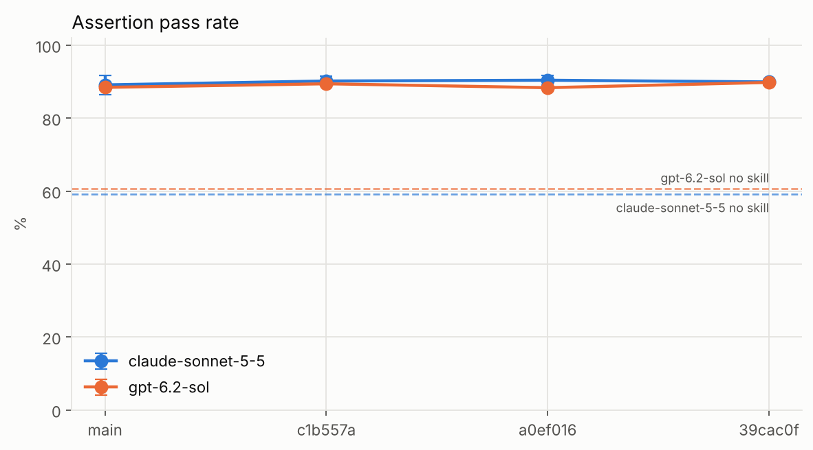
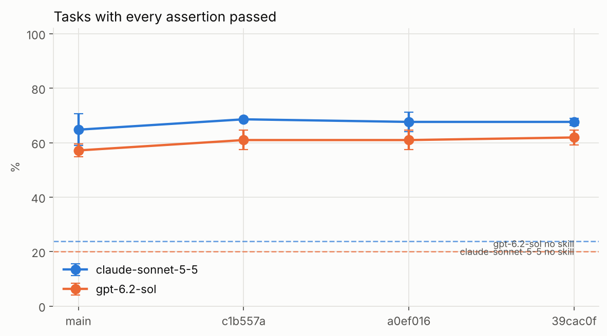
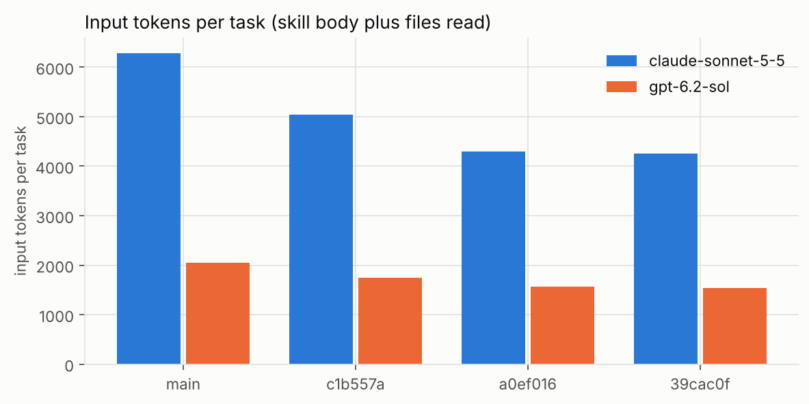
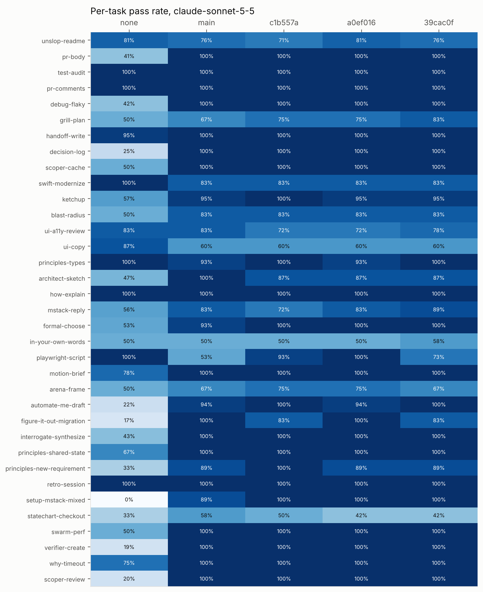
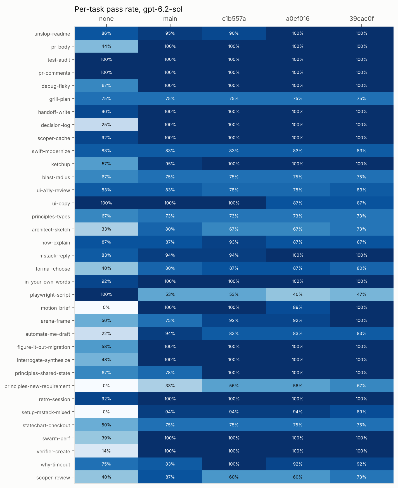
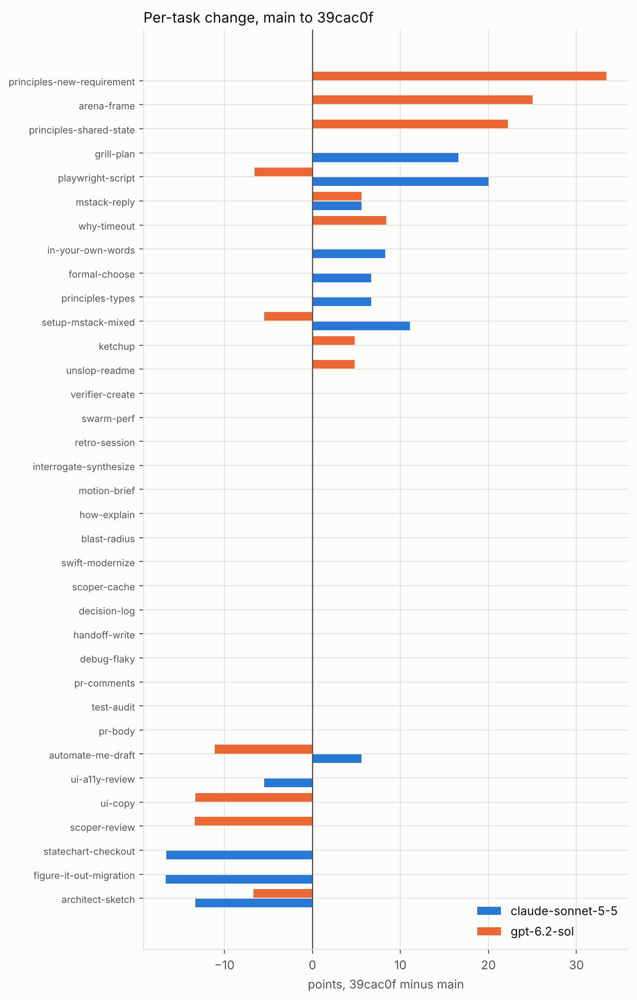
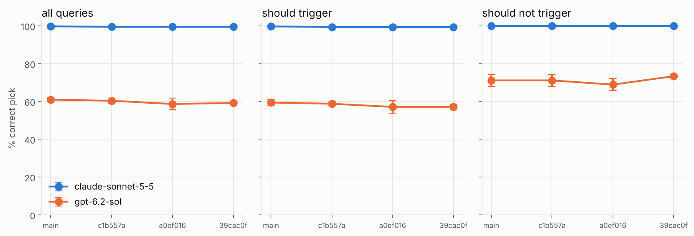
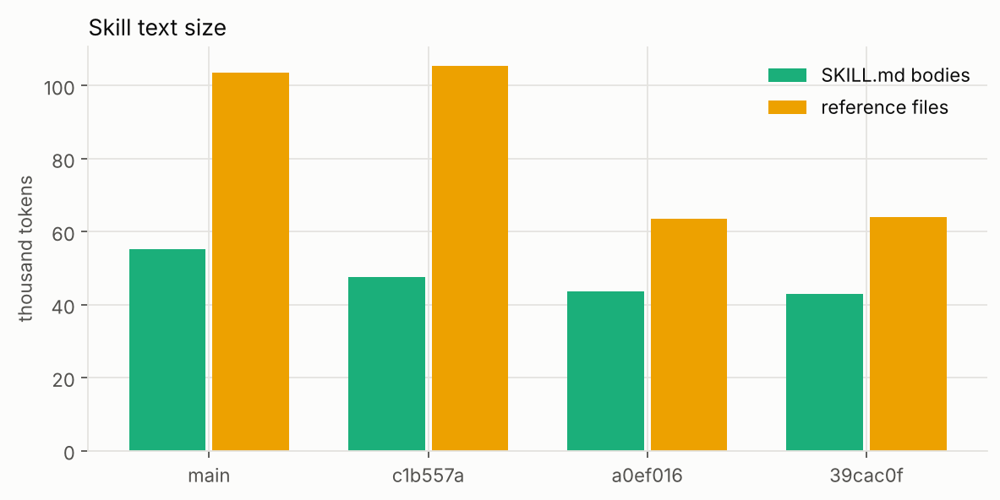

# Skill benchmark across versions

Versions, oldest first: `main`, `c1b557a`, `a0ef016`, `39cac0f`. Every version is scored on the same tasks and trigger queries. "none" is the same task with no skill loaded. Error bars and ± are the standard deviation across repeated runs.

## Task outcomes

35 tasks, 3 runs per cell, graded by regex checks plus judge `claude-opus-5-5`.

| Model | none | main | c1b557a | a0ef016 | 39cac0f |
|---|---|---|---|---|---|
| claude-sonnet-5-5 pass rate | 59.2% ± 0.2% | 89.1% ± 2.6% | 90.2% ± 1.3% | 90.4% ± 1.4% | 89.9% ± 0.5% |
| gpt-6.2-sol pass rate | 60.7% ± 0.8% | 88.4% ± 0.7% | 89.4% ± 0.5% | 88.3% ± 0.4% | 89.8% ± 0.7% |
| claude-sonnet-5-5 all pass | 23.8% ± 3.6% | 64.8% ± 5.9% | 68.6% ± 0.0% | 67.6% ± 3.6% | 67.6% ± 1.3% |
| gpt-6.2-sol all pass | 20.0% ± 0.0% | 57.1% ± 2.3% | 61.0% ± 3.6% | 61.0% ± 3.6% | 61.9% ± 2.7% |
| claude-sonnet-5-5 input tokens | 200 | 6283 | 5046 | 4294 | 4251 |
| gpt-6.2-sol input tokens | 140 | 2051 | 1752 | 1572 | 1534 |

Dropped jobs (API or judge failure after a retry): claude-sonnet-5-5 0, gpt-6.2-sol 0.

## Trigger accuracy

Share of runs where the model, given only the skill listing, picked an accepted skill (or none when no mstack skill fits).

| Model | Slice | main | c1b557a | a0ef016 | 39cac0f |
|---|---|---|---|---|---|
| claude-sonnet-5-5 | all queries | 99.7% ± 0.4% | 99.4% ± 0.4% | 99.4% ± 0.8% | 99.4% ± 0.4% |
| claude-sonnet-5-5 | should trigger | 99.7% ± 0.5% | 99.3% ± 0.5% | 99.3% ± 0.9% | 99.3% ± 0.5% |
| claude-sonnet-5-5 | should not trigger | 100.0% ± 0.0% | 100.0% ± 0.0% | 100.0% ± 0.0% | 100.0% ± 0.0% |
| gpt-6.2-sol | all queries | 60.9% ± 1.1% | 60.3% ± 1.4% | 58.6% ± 3.1% | 59.2% ± 1.1% |
| gpt-6.2-sol | should trigger | 59.4% ± 1.6% | 58.7% ± 1.2% | 57.1% ± 3.4% | 57.1% ± 1.2% |
| gpt-6.2-sol | should not trigger | 71.1% ± 3.1% | 71.1% ± 3.1% | 68.9% ± 3.1% | 73.3% ± 0.0% |

## Size

| Metric | main | c1b557a | a0ef016 | 39cac0f |
|---|---|---|---|---|
| skill_tokens_total | 55109 | 47667 | 43704 | 42983 |
| skill_tokens_median | 1430 | 1105 | 1099 | 1099 |
| ref_tokens_total | 103521 | 105438 | 63592 | 63921 |
| desc_tokens | 2189 | 2149 | 2149 | 2149 |
| scoper_hook_tokens | 1132 | 897 | 897 | 897 |
| broken_links | 1 | 1 | 0 | 0 |
| lint_failures | 2 | 1 | 1 | 0 |
